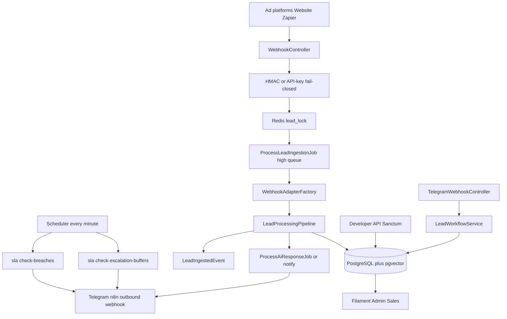

# System Data Flow

FirstTouch SLA is a multi-tenant lead response platform. Inbound marketing leads are verified fail-closed, assigned, timed against business-hours SLA, optionally answered by a credit-gated RAG pipeline, and surfaced through Filament, Telegram, n8n, and outbound webhooks.

This document is the authoritative **system pipeline / data-flow** reference. For a short overview see [ARCHITECTURE.md](../ARCHITECTURE.md). Feature code maps live under [docs/features/](../features/).

---

## End-to-end system data flow



### Happy path (Human First / AI Assisted)

1. Platform POSTs a signed webhook → `WebhookController`
2. Source + active tenant resolved; adapter signature validated; Redis `lead_lock:{externalLeadId}` acquired (300s)
3. `ProcessLeadIngestionJob` dispatched on Horizon queue `high`
4. Job rebuilds the request, re-extracts `LeadData`, runs `LeadProcessingPipeline`
5. Lead persisted; `LeadIngestedEvent` broadcasts to Filament
6. Scheduler drives 50% warn → 80% reassign → full breach escalate
7. Agent claims / in-progress / contacted via Filament or Telegram → SLA met; buffers cancelled
8. `LeadObserver` may POST the tenant outbound webhook

### AiFirst variant

Steps 1–3 same. Assign and SLA pipes are skipped at ingest. Lead persists as SLA `pending`. `ProcessAiResponseJob` runs; if qualified, `LeadSalesActivationService::activate()` assigns + starts SLA + notifies; otherwise managers get an account-status alert.

---

## Ingestion pipeline

### HTTP edge — before the queue

Source: [`app/Http/Controllers/Api/WebhookController.php`](../../app/Http/Controllers/Api/WebhookController.php)

1. Resolve `LeadSource` from route `{source}` + `Tenant` from `{tenant_id}` (must be active)
2. `WebhookAdapterFactory::resolve()` → adapter
3. `WebhookSecretResolver::resolve()` (tenant encrypted secret → env fallback)
4. `adapter->validateSignature()` — **fail-closed** (missing/invalid secret → 401)
5. Universal handshake short-circuit; website payload validation / normalize
6. `adapter->extractLeadData()` → `LeadData` DTO (for lock key)
7. Redis lock `lead_lock:{externalLeadId}` — duplicate → `already_processed` / 200
8. `ProcessLeadIngestionJob::dispatch($tenantId, $source, $payload, $headers)` on `high`
9. Immediate HTTP response (`accepted` / website `201`) — processing is async

### Queue worker — pipeline pipes

Source: [`app/Pipelines/LeadProcessingPipeline.php`](../../app/Pipelines/LeadProcessingPipeline.php)

`ProcessLeadIngestionJob` rebuilds a JSON `Request`, extracts `LeadData` again, then:

| Order | Pipe | Behavior |
|------:|------|----------|
| 1 | `VerifyIdempotencyPipe` | Skip duplicate `(tenant_id, external_lead_id)`; blank external IDs → `NULL` |
| 2 | `AssignRoundRobinSalesPipe` | `ContextAwareRoutingService` (tags ∩ skills, else round-robin); skipped for `AiFirst` |
| 3 | `CalculateSlaDeadlinePipe` | Working hours + `SlaCalculatorService`; may set `Frozen`; skipped for `AiFirst` |
| 4 | `PersistLeadPipe` | `Lead::create` + `LeadIngestedEvent` |
| 5 | `DispatchAiResponsePipe` | Credits + `ai_routing_mode` → `ProcessAiResponseJob` **or** `SendLeadAssignedNotificationJob` |

### AI routing modes

| Mode | Assign before AI? | Runs AI? | SLA start |
|------|-------------------|----------|-----------|
| `ai_first` | No | Yes | After qualify + `LeadSalesActivationService::activate()` |
| `human_first` | Yes | No | At ingest |
| `ai_assisted` | Yes | Yes (background) | At ingest |
| `human_only` | Yes | No | At ingest |

### Inbound sources & adapters

| Source | Adapter / driver |
|--------|------------------|
| `meta` | `MetaWebhookAdapter` |
| `tiktok` | `TikTokWebhookAdapter` |
| `google` | `GoogleAdsWebhookDriver` |
| `snapchat` | `SnapchatAdsWebhookDriver` |
| `universal` | `UniversalWebhookDriver` (+ handshake) |
| `website` | `WebsiteFormWebhookDriver` (API key + validation) |
| `manual` | Filament / internal (not webhook route) |

---

## Downstream async flows

### SLA lifecycle

Scheduler ([`routes/console.php`](../../routes/console.php)):

```
every minute  →  sla:check-escalation-buffers  →  ProcessSlaEscalationBuffersJob
every minute  →  sla:check-breaches            →  EscalateLeadSlaJob (per breach)
daily 00:00   →  DailyFreeCreditGrantJob
```

`SlaEscalationBufferService::processDueLeads()`:

- Unfreeze `Frozen` leads whose `sla_started_at` ≤ now
- **50%** progress → halfway warning + `SlaWarningBroadcastEvent`
- **80%** progress → unassign → reassign via `ContextAwareRoutingService` → reset SLA window
- Full breach (`sla:check-breaches`) → `sla_status=breached` + escalation alert via notification driver

Agent first action (`LeadWorkflowService::markInProgress` / `markContacted`):

- Sets `first_action_at`, cancels buffers
- Contacted → `sla_status=met`

### RAG / knowledge (side path)

```
Filament KnowledgeBase save
  → KnowledgeIngestionService::ingestFromFormData()
  → ProcessKnowledgeDocumentJob
  → TextChunkerService → OpenAiEmbeddingService
  → knowledge_chunks.embedding (pgvector)

Lead AI path
  → ProcessAiResponseJob
  → RagInferenceService::processLeadQuery()
  → credit gate → embed brief → VectorSearchService
  → confidence vs TenantSetting.ai_confidence_threshold
  → OpenRouterLlmService → deduct credit
  → write meta_data / ai_quick_replies / routing_tags
```

### Notifications & egress

| Exit | Trigger | Mechanism |
|------|---------|-----------|
| Telegram / n8n / log | Assignment, 50%, 80%, breach, account status | `NotificationDriverFactory` |
| Outbound tenant webhook | Lead status / SLA / assignee change | `LeadObserver` → `DispatchOutboundWebhookJob` + HMAC `X-FirstTouch-Signature` |
| Filament realtime | Ingest / SLA warning | `LeadIngestedEvent`, `SlaWarningBroadcastEvent` on `tenant.{id}` |
| Developer API | Partner reads | Sanctum JSON |
| Telegram callbacks | Claim / reply buttons | `TelegramWebhookController` → `TelegramQuickReplyCallbackHandler` |
| Payments | Stripe / mock webhook | Credit ledger |

---

## Runtime topology (Sail)

| Service | Role |
|---------|------|
| `laravel.test` | HTTP / Filament `/admin` / API |
| `horizon` | Redis queues: `default`, `high`, `notifications` |
| `scheduler` | SLA sweeps + daily free credits |
| `pgsql` | PostgreSQL 18 + `pgvector` |
| `redis` | Cache, locks (`lead_lock:*`), queues |
| `mailpit` | Local mail |
| `n8n` | Optional notification workflow runner |

### Horizon job map

| Job | Queue | Role |
|-----|-------|------|
| `ProcessLeadIngestionJob` | `high` | Run lead pipeline |
| `ProcessAiResponseJob` | `high` | RAG inference |
| `SendLeadAssignedNotificationJob` | `notifications` | Assignment alert |
| `EscalateLeadSlaJob` | `notifications` | Breach alert |
| `ProcessSlaEscalationBuffersJob` | `notifications` | 50% / 80% sweep |
| `DispatchOutboundWebhookJob` | `notifications` | Tenant outbound HTTP |
| `ProcessKnowledgeDocumentJob` | `default` | Chunk + embed |
| `RegisterTelegramWebhookJob` | — | Bot token change |
| `DailyFreeCreditGrantJob` | — | Daily free credit |

---

## Key code map

| Context | Paths |
|---------|-------|
| Ingestion | `app/Http/Controllers/Api/WebhookController.php`, `app/Adapters/Webhooks/`, `app/Services/Webhooks/`, `app/Pipelines/`, `app/Jobs/ProcessLeadIngestionJob.php`, `app/DTOs/LeadData.php` |
| Assignment | `app/Services/Assignment/ContextAwareRoutingService.php`, `app/Services/Leads/RoundRobinAssignerService.php`, `app/Services/Leads/LeadSalesActivationService.php`, `app/Services/Leads/LeadWorkflowService.php` |
| SLA | `app/Services/Sla/`, `app/Console/Commands/CheckSlaBreachesCommand.php`, `app/Console/Commands/CheckSlaEscalationBuffersCommand.php` |
| AI / Knowledge | `app/Services/Ai/`, `app/Services/Knowledge/`, `app/Jobs/ProcessAiResponseJob.php`, `app/Jobs/ProcessKnowledgeDocumentJob.php` |
| Notifications | `app/Adapters/Notifications/`, `app/Services/Telegram/`, `app/Jobs/SendLeadAssignedNotificationJob.php` |
| Billing | `app/Services/Billing/`, `app/Services/Payments/`, `app/Http/Controllers/Api/PaymentWebhookController.php` |
| Tenancy | `app/Traits/BelongsToTenant.php`, `app/Models/Scopes/TenantScope.php` |
| Ops UI | `app/Filament/` |
| API routes | `routes/api.php` |

---

## Interactive API Spec · steering

Steering catalog for humans and agents. Derived from [`routes/api.php`](../../routes/api.php). All paths are under the `/api` prefix.

### Auth — `throttle:5,1`

| Method | Path | Auth | Purpose | Success | Errors | Downstream |
|--------|------|------|---------|---------|--------|------------|
| `POST` | `/api/v1/auth/register` | none | Register tenant owner | `201` JSON user/tenant | `422` validation | `TenantRegistrationService` |
| `POST` | `/api/v1/auth/forgot-password` | none | Send reset link | `200` | `422` | Mail |
| `POST` | `/api/v1/auth/reset-password` | none | Reset password | `200` | `422` | User password update |

### Inbound lead webhooks — `throttle:60,1`

Auth: adapter-specific HMAC or website API key via `WebhookSecretResolver` (**fail-closed**).

| Method | Path | Purpose | Success | Errors | Downstream |
|--------|------|---------|---------|--------|------------|
| `POST` | `/api/v1/webhooks/meta/{tenant_id}` | Meta lead ads | `200` `{ "status": "accepted" }` | `400` invalid_source, `404` tenant, `401` unauthorized, `200` already_processed | `ProcessLeadIngestionJob` → pipeline |
| `POST` | `/api/v1/webhooks/tiktok/{tenant_id}` | TikTok leads | same | same | same |
| `POST` | `/api/v1/webhooks/google/{tenant_id}` | Google Ads leads | same | same | same |
| `POST` | `/api/v1/webhooks/snapchat/{tenant_id}` | Snapchat leads | same | same | same |
| `POST` | `/api/v1/webhooks/universal/{tenant_id}` | Zapier / Make / generic | `200` accepted **or** handshake `{ "status": "connected" }` | same | same |
| `POST` | `/api/v1/webhooks/website/{tenant_id}` | Website form | `201` `{ success, message, source }` | `401` Invalid API Key, `422` validation, `200` already received | same |
| `POST` | `/api/v1/webhooks/{source}/{tenant_id}` | Catch-all dispatch | same as source | `400` if unknown source | same |

### Telegram — `throttle:60,1`

| Method | Path | Auth | Purpose | Success | Errors | Downstream |
|--------|------|------|---------|---------|--------|------------|
| `POST` | `/api/v1/webhooks/telegram/{tenant_id}` | `X-Telegram-Bot-Api-Secret-Token` (fail-closed) | Bot updates / inline callbacks | `200` | `401` / `404` | `TelegramQuickReplyCallbackHandler` → claim / workflow |

### Payments — `throttle:60,1`

| Method | Path | Auth | Purpose | Success | Errors | Downstream |
|--------|------|------|---------|---------|--------|------------|
| `POST` | `/api/v1/payments/webhook/{driver}` | Driver-specific (`mock` / Stripe signature) | Credit top-up events | `200` | `400` / `401` | Payment driver → credit ledger |

### Developer API — Sanctum

Middleware: `auth:sanctum`, `abilities:developer:*`, `EnsureTenantApiAccess`.

Header: `Authorization: Bearer <token>`

| Method | Path | Extra auth | Purpose | Success | Errors | Downstream |
|--------|------|------------|---------|---------|--------|------------|
| `GET` | `/api/v1/developer/leads` | tenant scope | List leads (`status`, `per_page` 1–100, default 15) | paginated `LeadApiResource` | `401` / `403` | Read `leads` |
| `GET` | `/api/v1/developer/leads/{id}` | tenant scope | Show one lead | `LeadApiResource` | `404` Lead not found | Read `leads` |
| `GET` | `/api/v1/developer/analytics/sla-summary` | tenant scope | SLA compliance summary | `SlaAnalyticsResource` | `401` / `403` | Aggregate `leads` |
| `POST` | `/api/v1/developer/tokens` | owner settings | Issue token | `201` `{ token, token_type, name }` | `403` Forbidden, `422` | Sanctum PAT `developer:*` |
| `DELETE` | `/api/v1/developer/tokens/{tokenId}` | owner settings | Revoke token | `{ "message": "Token revoked." }` | `403`, validation token not found | Delete PAT |

Tokens can also be created/revoked in Filament **Tools → Developer API** (`DeveloperApiPage`).

### Curl examples

**Meta (or any ad) webhook** — signature headers vary by adapter; body is platform JSON:

```bash
curl -sS -X POST "http://localhost/api/v1/webhooks/meta/{tenant_id}" \
  -H "Content-Type: application/json" \
  -H "X-Hub-Signature-256: sha256=<hmac>" \
  -d '{"entry":[{"changes":[{"value":{"leadgen_id":"ext-1","field_data":[]}}]}]}'
```

**Developer leads list:**

```bash
curl -sS "http://localhost/api/v1/developer/leads?per_page=15" \
  -H "Authorization: Bearer <plain-text-token>" \
  -H "Accept: application/json"
```

**SLA analytics:**

```bash
curl -sS "http://localhost/api/v1/developer/analytics/sla-summary" \
  -H "Authorization: Bearer <plain-text-token>" \
  -H "Accept: application/json"
```

---

## Config that steers the pipeline

| Area | Env / setting |
|------|----------------|
| Runtime | `DB_*`, `QUEUE_CONNECTION=redis`, `REDIS_*`, `CACHE_STORE=redis` |
| Webhook secrets | `WEBHOOKS_*_SECRET` + per-tenant `TenantSetting` overrides |
| AI | `OPENAI_API_KEY`, `OPENROUTER_API_KEY`, `OPENROUTER_MODEL`; tenant `ai_routing_mode`, `ai_confidence_threshold`, credits |
| Notifications | `TELEGRAM_*`, `N8N_WEBHOOK_URL`; tenant `notification_driver`, outbound webhook URL/secret |
| Billing | `PAYMENT_DRIVER` (`mock` / `stripe`), `STRIPE_*` |
| SLA | `TenantSetting.sla_timeout_minutes` (default 5), timezone, `TenantWorkingHour` + `OffHoursAction` |

---

## Related docs

- [Architecture overview](../ARCHITECTURE.md)
- [SLA engine](../features/sla-engine.md)
- [Leads inbox](../features/leads-inbox.md)
- [AI RAG](../features/ai-rag.md)
- [Webhook security](../features/webhook-security.md)
- [Telegram alerts](../features/telegram-alerts.md)
- [n8n automation](../features/n8n-automation.md)
- [Billing & credits](../features/billing-credits.md)
- [Developer API](../features/developer-api.md)
